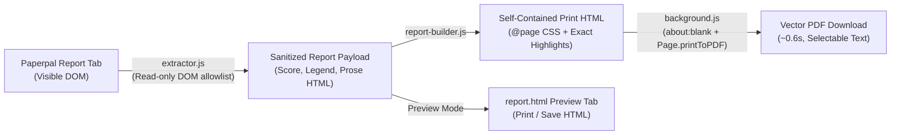

# Paperpal AI Report PDF Exporter

[](https://developer.chrome.com/docs/extensions/mv3/intro/)
[](LICENSE)
[](#privacy--permissions)

A lightweight, privacy-first **Manifest V3 Chrome extension** that exports the full visible **Paperpal AI Detection** report (`edit.paperpal.com/ai-detector/report/...`) into a clean, searchable, multi-page vector PDF in under a second—without scrollable container clipping.

---

## Why I Built This

When reviewing an AI detection scan on Paperpal, the highlighted manuscript is rendered inside a fixed-height scrollable viewer (`#ai-detection-editor-container`, ~752px tall with `overflow-y: auto`).

If you try to archive or share your scan results for revision tracking, advisor review, or personal record-keeping using standard browser printing (`Ctrl+P` → **Save as PDF**), Chrome clips the scrollable pane right after the first visible viewport—cutting off the rest of the document. Taking and stitching manual screenshots loses selectable text, clickable reference URLs, and clean pagination.

I built **Paperpal AI Report PDF Exporter** to solve that exact workflow bottleneck:

- **One click, full document:** Extracts the already-rendered HTML from the report viewer and lays it out across properly paginated US Letter or A4 pages with zero viewport clipping.
- **Faithful highlights & links:** Preserves Paperpal's rendered highlight tiers (AI-written, Human–AI Blend tiers, Human-written, and gray unprocessed text), typography, and clickable citations/reference links.
- **Fast, native vector PDF:** Uses Chrome's built-in DevTools PDF renderer (`Page.printToPDF`) on an isolated background `about:blank` tab—producing crisp, selectable text PDFs in ~0.6 seconds with zero external servers or heavy JS PDF libraries.

---

## Features

- **1-Click Direct PDF Download:** Generates and downloads `Paperpal_AI_Report_<Document_Title>_<YYYY-MM-DD>.pdf` straight to your Chrome Downloads folder.
- **Interactive Print Preview & HTML Export:** Open a formatted preview tab at any time to inspect pagination, trigger Chrome's native print dialog manually, or export a self-contained `.html` archive.
- **Unobtrusive Floating Action Pill:** Renders a compact **Export PDF / Preview** pill inside an isolated Shadow DOM on Paperpal AI Detection report pages (with a dismiss button and zero interference with Paperpal's UI).
- **Toolbar Popup Controls:** Configure US Letter vs. A4 paper size, toggle the score summary card & highlight color key, toggle the source URL footer, or enable "Ask where to save each time."
- **Smart Pagination:** Automatically detects section headings and applies `break-after: avoid` so headings are never orphaned at the bottom of a page, with running `Page X of Y` footers.
- **Dynamic Color Matching:** Reads the live rendered score color, verdict callout pill styling, and active highlight classes directly from the page so the legend matches every report automatically.
- **Graceful Fallback:** If `chrome.debugger` is restricted by browser policy, the extension automatically opens the formatted Print Preview tab with the print dialog ready.

---

## Scope & Fair-Use Notice

This extension is strictly a **print-friendly formatter** for content already displayed in your browser:

- It reads **only** the visibly rendered report DOM (`#ai-detection-editor-container .ProseMirror`) and visible summary elements already on screen.
- It does **not** bypass Paperpal's free-tier limits, unblur locked/redacted breakdown percentages, intercept hidden API responses, spoof subscription states, or unlock paid features. Any blurred breakdown counts or unscanned text beyond Paperpal's scan limit remain excluded/unprocessed exactly as shown on the page.
- This is an independent, personal open-source utility and is **not** affiliated with, endorsed by, or sponsored by Paperpal or Cactus Communications.

---

## Installation (Chrome / Edge / Brave / Chromium)

1. **Clone or download this repository:**
   ```bash
   git clone https://github.com/JehadurRE/paperpal-ai-report-pdf.git
   ```
   *(Or click **Code → Download ZIP** on GitHub and extract it to a permanent folder.)*
2. Open Chrome and navigate to `chrome://extensions/`.
3. Toggle **Developer mode** ON in the top-right corner.
4. Click **Load unpacked** and select the cloned/extracted `paperpal-ai-report-pdf` folder.
5. *(Optional)* Click the Extensions puzzle icon in Chrome's toolbar and pin **Paperpal Visible Report PDF Exporter** for quick access.

---

## Usage

Open any Paperpal AI Detection report at `https://edit.paperpal.com/ai-detector/report/...`:

- **From the page:** Click the **Export PDF** pill in the bottom-right corner for an instant download, or click **Preview** to inspect/print/save as HTML.
- **From the toolbar:** Click the extension icon to see live report status (detected AI score, title, paragraph count, coverage), adjust PDF preferences, and click **Download PDF** or **Open Print Preview**.

---

## How It Works



### Project Structure

| File | Responsibility |
| --- | --- |
| `manifest.json` | Manifest V3 configuration, permissions, content script rules, and icons |
| `extractor.js` | Read-only visible DOM parser and strict HTML tag/attribute allowlist sanitizer |
| `report-builder.js` | Shared standalone HTML & `@page` print stylesheet generator used by both PDF and HTML export |
| `background.js` | MV3 service worker orchestrating `about:blank` → `Page.setDocumentContent` → synchronous layout reflow → `Page.printToPDF` → `chrome.downloads` |
| `content.js` | SPA-aware content script mounting an isolated Shadow DOM floating export pill |
| `popup.html` / `popup.js` / `popup.css` | Toolbar popup UI, live report inspection, and persisted user preferences |
| `report.html` / `report.js` / `report.css` | Interactive Print Preview tab with Print, Direct PDF, and Standalone HTML actions |
| `icons/` | Custom 16px, 48px, and 128px extension icons |

---

## Privacy & Permissions

**Zero external network requests. Zero analytics. Zero telemetry.** All extraction, formatting, and PDF rendering run 100% locally inside your browser.

| Permission | Why It Is Needed |
| --- | --- |
| `host_permissions` (`https://edit.paperpal.com/*`) | Scope content script and extraction strictly to Paperpal report pages |
| `activeTab` & `scripting` | Inspect the active Paperpal report tab when you click the toolbar icon |
| `tabs` | Create and immediately close an isolated background `about:blank` tab for PDF rendering (or open Print Preview) |
| `debugger` | Attach strictly to the extension's temporary `about:blank` tab (never to Paperpal's tab) for <1s to invoke Chrome's native `Page.printToPDF`, then immediately detach |
| `downloads` | Save the generated PDF directly to your Downloads folder with a clean filename |
| `storage` | Store your paper-size/header preferences locally (`storage.local`) and pass report payloads to Preview tabs (`storage.session`) |

---

## License

Licensed under the [MIT License](LICENSE) — Copyright (c) 2026 [JehadurRE](https://github.com/JehadurRE).
